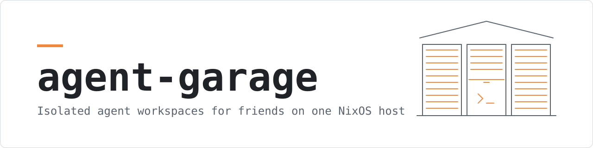
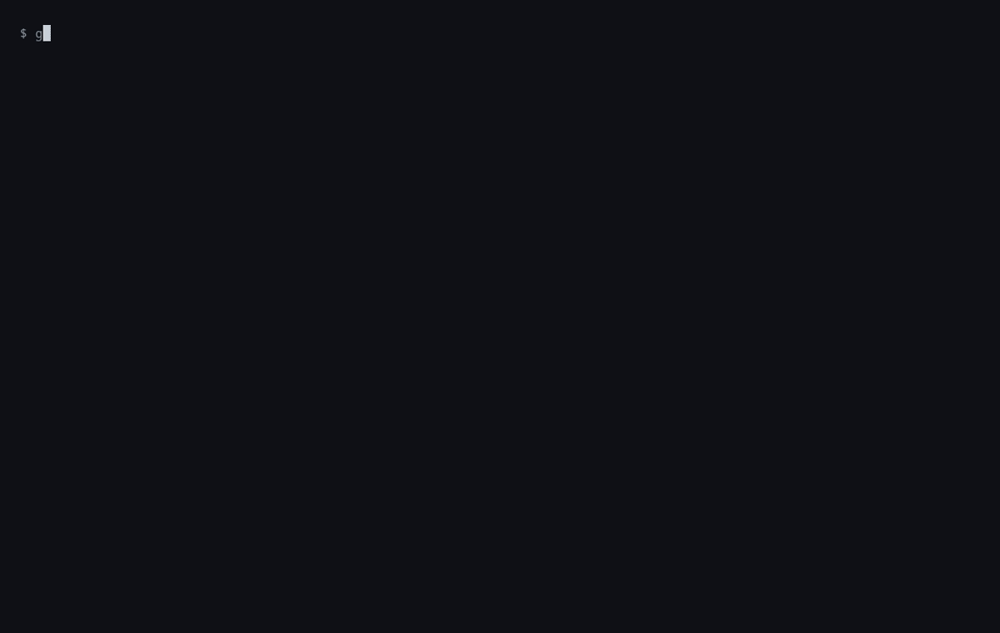

<div align="center">

<picture>
  <source media="(prefers-color-scheme: dark)" srcset="docs/assets/banner-dark.svg">
  
</picture>

# agent-garage

### Isolated agent workspaces for friends on one NixOS host

**Gives each of a few friends a NixOS microVM with Claude Code and T3 Code on your own host, reachable only through Cloudflare Access and cut off from the host, its network and each other.**

[](LICENSE)
[](#quick-start)
[](#how-it-works)
[](infra/cloudflare)
[](#the-way-in)

[Quick start](#quick-start) · [How it works](#how-it-works) · [The way in](#the-way-in) · [Isolation](#isolation) · [Testing](#testing) · [Status and limits](#status-and-limits) · [Security model](docs/security.md)

<br>



<sub>A real run on the host, sped up and with the long waits cut: <code>garage status</code>, then the acceptance tests for one bay, from the host and from inside the bay. Addresses, the domain, ids and the bay names are replaced by <a href="docs/demo/redact">docs/demo/redact</a>; recorded with <a href="docs/demo/garage.tape">docs/demo/garage.tape</a>.</sub>

</div>

---

A bay is a small NixOS virtual machine on a host you run, with Claude Code, T3
Code, git and Nix in it, opened in a browser at its own URL. I built it so two
or three friends can run coding agents with full permissions on hardware that
is on all the time, without those agents ever seeing the host's files, its
network or each other. One NixOS module and one OpenTofu directory set up the
whole thing; everything specific to an installation lives in one site file.

- **One microVM per friend, not a container.** Each bay is a cloud-hypervisor
  VM declared with [microvm.nix](https://github.com/microvm-nix/microvm.nix):
  its own kernel, a fixed vCPU and RAM cap, a 100 GiB sparse volume for `/home`
  and its writable Nix store, and a read-only store image built from its own
  closure. Nothing of the host is mounted into it.
- **One way in.** Cloudflare Tunnel dials out from the host, so no port is
  opened. Cloudflare Access asks for a GitLab login, then a passkey or security
  key, and lets only the bay owner's numeric GitLab user id through.
  cloudflared checks the Access token a second time before a request reaches
  the bay.
- **A bay reaches the internet and nothing else.** nftables on the host drops
  traffic to the host, the LAN, the tailnet, other bays, outgoing mail and all
  of IPv6. Bridge ports are isolated and each one may only use its own MAC and
  address.
- **Optional VPN egress per bay.** A bay can leave through a WireGuard tunnel
  that runs on the host, with a kill switch in routing and in nftables, so its
  agents' traffic never comes from the home IP.
- **Everyone uses their own accounts.** Each friend signs in to Claude Code
  (or another provider) with their own subscription or API key, as
  [Anthropic's terms](https://code.claude.com/docs/en/legal-and-compliance)
  require, and brings their own git tokens.
- **The host checks itself.** `sudo garage test <bay>` ran 123 checks for a
  bay without VPN egress on the reference host, 81 of them inside the bay over a vsock channel,
  and exits non-zero on any failure.

> [!IMPORTANT]
> Isolation protects the host and the other bays from a bay. It does not protect
> a bay from the host: whoever has root on the host can read every file,
> process and packet in every bay. The bay guide says so to every friend
> before they get access. Details in [SECURITY.md](SECURITY.md).

> [!NOTE]
> Built for a handful of people, not as a hosting service: one host, a
> domain on Cloudflare, GitLab as the identity provider. Your domain,
> Cloudflare ids, bays and GitLab ids go in a site file next to your host
> configuration, never in the repo; [examples/site/](examples/site/) shows
> the format.

## Quick start

| Need | Details |
|---|---|
| Host | NixOS on x86_64 with `/dev/kvm`, flakes enabled (`nix.settings.experimental-features = [ "nix-command" "flakes" ]`), a wired uplink; per bay about 7 GiB RAM (6 GiB guest plus hypervisor) and up to 100 GiB disk |
| Cloudflare | a zone, Zero Trust (the free plan covers 50 users), an API token with Tunnel Write, Access Apps and Policies Write, Access IdP and Organisation Read, and DNS Write, Zone Transform Rules Write plus Zone Read on the zone |
| Identity | a GitLab OAuth application (scopes `openid profile`, redirect URI `https://<team>.cloudflareaccess.com/cdn-cgi/access/callback`), added in Zero Trust as a generic OIDC provider: auth URL `https://gitlab.com/oauth/authorize`, token URL `https://gitlab.com/oauth/token`, certificate URL `https://gitlab.com/oauth/discovery/keys`, PKCE on, claim `sub` |
| Users | each friend's numeric GitLab user id (`https://gitlab.com/api/v4/users?username=<name>`), never the username |

1. **Clone it and write the site.** Copy the example out of the repo and
   replace every value: Cloudflare account id, zone, team name and identity
   provider id, and one entry per bay (address, MAC, size, hostname, GitLab
   ids). Drop `egress` from a bay unless you set up a VPN for it.

   ```sh
   git clone https://github.com/minomat180/agent-garage && cd agent-garage
   sudo mkdir -p /etc/nixos/agent-garage
   sudo cp examples/site/site.nix /etc/nixos/agent-garage/site.nix
   ```

2. **Create the Cloudflare side** (tunnel, one Access app and policy per bay,
   DNS, the HSTS rule) with OpenTofu. First, in the Zero Trust dashboard's
   authentication settings, turn on independent MFA and allow only biometrics
   and security keys; the identity provider and these settings are not in
   OpenTofu. The token is a file only `tofu` sees; the state stays in
   `~/.local/state/agent-garage/tofu`. `apply` takes over the account's App
   Launcher and the zone's response-header transform rules: if you already use
   either, import them first or use a zone of its own.

   ```sh
   # paste the API token, then Ctrl-D
   (umask 077; mkdir -p ~/.config/agent-garage && cat > ~/.config/agent-garage/cloudflare-api-token)
   infra/cloudflare/garage-cf init
   infra/cloudflare/garage-cf plan
   infra/cloudflare/garage-cf apply
   infra/cloudflare/garage-cf export                # outputs.json next to site.nix (version it with the site)
   infra/cloudflare/garage-cf install-credentials   # tunnel credentials -> root-only file
   ```

3. **Import the host module**, pinned by commit, in `/etc/nixos/configuration.nix`:

   ```nix
   imports = [
     ((builtins.getFlake "github:minomat180/agent-garage/<commit>").lib.hostModule
       (import ./agent-garage/site.nix))
   ];
   garage = {
     enable = true;
     uplinkInterface = "enp3s0";   # the wired interface bays are masqueraded out of
   };
   ```

   With a flake-based host, add the input
   `agent-garage.url = "github:minomat180/agent-garage";` and put
   `(agent-garage.lib.hostModule (import ./agent-garage/site.nix))` in the
   system's `modules`. Then `sudo nixos-rebuild test`, check that your own way
   in (sshd, Tailscale) is still up, and `sudo nixos-rebuild switch`.

4. **Check it and hand it over.**

   ```sh
   sudo garage test alice   # acceptance tests; non-zero exit on any failure
   sudo garage pair alice   # one-time T3 pairing link, valid 15 minutes
   ```

   Send the friend [docs/bay-guide.md](docs/bay-guide.md) and the pairing link.
   They sign in with GitLab, register a passkey, open the link and are in.

For VPN egress, put a wg-quick config (an IPv4 /32 `Address`, `Endpoint` as
IPv4:port) at `/var/lib/agent-garage/egress/<bay>.conf` (root, mode 600,
directory 700) and add `egress.wireguardConfig` to that bay in the site.

## How it works

```text
friend's browser
  |  https://<hostname>.<zone>
  v
Cloudflare edge
  Access app per bay: GitLab login (OIDC), then passkey or security key;
  one Allow rule: the owner's numeric GitLab user id
  |
  |  Cloudflare Tunnel (outbound from the host, no inbound port)
  v
host (NixOS)
  garage-cloudflared   hostname -> bay:3773, Access JWT checked again, 404 for anything else
  garage-nftables      bays -> public internet only
  garage-egress-<bay>  optional WireGuard tunnel for one bay, with kill switch
  |
  +-- bay-<name>   microVM: own kernel, own store image, 100 GiB volume
  |                T3 Code server on the bay address, Claude Code, git, gh, glab, Nix
  +-- bay-<name>   ...
```

| Path | What |
| --- | --- |
| `flake.nix` | `lib.hostModule site`, `lib.tofuVars site`, and checks that build the example site |
| `lib/garage.nix` | network constants and the validation of a site |
| `modules/guest.nix` | the bay: NixOS guest, T3 as a user service, vsock services for pairing and tests |
| `modules/host.nix` | microvm.nix host, bridge, nftables, systemd sandboxing, the `garage` command |
| `modules/public.nix` | cloudflared for the public bays |
| `modules/egress.nix` | WireGuard egress, policy routing, kill switch |
| `infra/cloudflare/` | OpenTofu for the tunnel, Access, DNS and HSTS; `garage-cf` runs it |
| `pkgs/t3.nix` | T3 Code server, the official release pinned by sha256 |
| `guest/bay-rules.md` | installed as `~/.claude/CLAUDE.md` in every bay |
| `tests/` | `garage-host.sh` (the `garage` command) and `bay-selftest.sh` (runs inside a bay) |
| `examples/site/` | the site format with placeholder values |

The host talks to a bay only through its vsock socket, for two things: minting
a T3 pairing link and running the in-bay half of the tests. The bay side of
both services refuses any peer that is not the host. There is no SSH server
and no login console in a bay; T3's terminal is the shell, and the `bay` user
has passwordless `sudo` inside its own VM.

## The way in

Every bay hostname is an Access application with exactly one Allow policy: an
OIDC `sub` claim equal to the owner's GitLab user id. The id is used instead of
the username because a username can be renamed and taken by someone else.
Access requires a second factor of type passkey or security key; there is no
TOTP or email fallback. Sessions last 12 hours. Users register their passkey at
`https://<team>.cloudflareaccess.com/AddMfaDevice`, which needs an App Launcher
application; `infra/cloudflare/main.tf` creates one with the same users and
hides the bays from it.

Behind the edge, cloudflared is configured with `access.required` and the
bay's AUD tag on every ingress rule, so a request that skipped Access is
rejected before it reaches the bay, and any other hostname gets a 404. The bay
hostnames send `Strict-Transport-Security: max-age=31536000`, so a browser
that has seen it refuses to click through a certificate error (for
example behind a TLS-inspecting proxy). Inside the bay, T3
still requires a paired device. `sudo systemctl stop garage-cloudflared` takes
every bay off the internet at once.

## Isolation

| From a bay to | Result | Enforced by |
|---|---|---|
| public internet | allowed (TCP 25 dropped, new connections rate-limited) | nftables `from_bay` chain, masquerade on the uplink or the bay's tunnel |
| the host, any port | dropped | nftables `input` chain on the bridge |
| LAN, tailnet, link-local, CGNAT, other special ranges | dropped | nftables, 13 IPv4 ranges |
| another bay | dropped | isolated bridge ports, MAC and address pinning in a `bridge` table |
| anything over IPv6 | dropped | IPv6 off on the bridge, taps and in the guest; nftables drops the rest |
| the host's files and store | not there | no virtiofs or 9p shares; the bay boots from an erofs image of its own closure |

The nftables tables are loaded by their own unit before any bay starts, every
bay unit requires them, and the unit has no stop action, so restarting it never
leaves a gap. Each bay's hypervisor runs as the unprivileged `microvm` user
under systemd sandboxing with only `/dev/kvm`, `/dev/net/tun` and
`/dev/vhost-net`, and KSM is off so VMs share no memory pages.

With VPN egress the bay's packets are routed by source address into its own
table (tunnel as default route, `unreachable` as fallback, rule priority ahead
of Tailscale's), and nftables drops any packet from that bay that would leave
through anything but its tunnel. The WireGuard private key is read at run time
through `LoadCredential` and never enters the Nix store.

## Testing

```sh
nix flake check   # evaluates the host module, builds both example bays, shellcheck and tofu fmt
nix fmt -- --check $(git ls-files '*.nix')
nix run nixpkgs#statix -- check . && nix run nixpkgs#deadnix -- --fail .
nix run nixpkgs#gitleaks -- git .
garage status               # bays, units, public URLs, egress
sudo garage test <bay>      # acceptance tests on the live host
```

`garage test` checks, among other things: the host units are up, and sshd,
Tailscale and its routing rules too when they are enabled; no port on the host's tailnet or LAN address leads
into a bay; cloudflared's ingress rules and the Access check; nine requests to
the public URL without a valid login (forged cookie, forged header, forged
websocket, plain HTTP) are all redirected to the login or to HTTPS, never
answered by T3; from inside the bay, every host address on 7 ports, the LAN
gateway on 3 and every other bay on 14 are unreachable,
mail to port 25 is dropped, HTTPS and DNS to the internet work, no IPv6, only
T3 listening, the store holds only the bay's own closure, and a search of the
whole filesystem finds none of the host's names or addresses outside the bay
user's own files. For a VPN bay it
also stops the tunnel, removes the routing rule, and checks that nothing left
through the uplink; that cuts the bay's internet for about 30 seconds. Run one
`garage test` at a time: two runs share the stand-in bay and interfere.

The last run on the host for the bay without VPN egress: `SUMMARY pass=123 fail=0`; for the bay with VPN egress, `SUMMARY pass=152 fail=0`.

## Status and limits

Live since 2026-11-24 with two bays on an i7-9750H with 31 GiB RAM.
An idle bay used 0.3 to 1.1% of one core in three test runs, and its hypervisor
process held about 4.5 GiB; the guest has 6 GiB and the unit is capped at
7 GiB (measured by `garage test`). The ceiling on this machine
is three bays.

Not built yet: a browser for agents and a secret store inside the bays,
alerting on denied logins, and CI for this repo.

Known gaps (more in [docs/security.md](docs/security.md#known-gaps)):

- The host admin can read everything in a bay (no disk encryption).
- T3's logs in a bay keep the Host header of every request: the bay's public
  hostname, or any other address it was ever opened through.
- T3 downloads npm packages into the bay at first start; those are not pinned
  by this repo.
- The Nix database inside a bay lives on the RAM root and resets on reboot;
  store paths on the volume survive but are registered again only when rebuilt
  or fetched.
- A bay without VPN egress can connect to the home's own public IP (hairpin);
  the router's port forwards decide what that reaches.
- `garage.uplinkInterface` is an interface name. If yours can change (USB
  adapters do), pin it with a `systemd.network.links` rule. After a reboot of
  the reference host, everything came back on its own within 5 seconds of each
  other, but a renamed adapter left the bay without VPN egress offline.
- Bays follow this repo's `flake.lock`, not the host's own upgrades; updating
  them is a manual lock bump and rebuild.

The design, the options I rejected (Coder, containers, Tailscale Funnel, an own
identity provider) and the threat model are in [docs/design.md](docs/design.md).

## Credits

[microvm.nix](https://github.com/microvm-nix/microvm.nix) does the VM plumbing;
Michael Stapelberg's
[Coding Agent VMs on NixOS with microvm.nix](https://michael.stapelberg.ch/posts/2026-02-01-coding-agent-microvm-nix/)
was the starting point. [T3 Code](https://github.com/pingdotgg/t3code) is the browser UI in
every bay. [cloudflared](https://github.com/cloudflare/cloudflared) and
Cloudflare Access are the way in.

## License

MIT, see [LICENSE](LICENSE).
